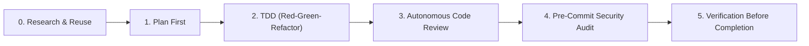

# ECC Workflow (Everything Claude Code Agent Harness)

The ultimate agent harness performance optimization system based on [affaan-m/everything-claude-code](https://github.com/affaan-m/everything-claude-code). It equips AI coding agents with research-first development, TDD discipline, systematic debugging, automated code reviews, and verification gates.

---

## 🏛️ The 6-Stage ECC Development Pipeline

Every non-trivial engineering task follows the ECC standard pipeline:



### Stage 0: Research & Reuse (Mandatory Before Coding)
1. **GitHub Code Search First:** Search GitHub repositories and existing code for proven implementations or templates before writing anything new:
   ```bash
   gh search repos "<keyword>" --limit 5
   gh search code "<pattern>" --limit 5
   ```
2. **Library Docs First:** Confirm API signatures, versions, and patterns in official vendor documentation rather than guessing.
3. **Agent Reach for Web Intel:** When external platform discussions, issue threads, or benchmarks are needed, invoke `agent-reach` to gather structured findings without API fees.
4. **Registry Verification:** Search package managers (npm, PyPI, crates.io) for battle-tested libraries before writing custom utilities.

### Stage 1: Plan First
1. Never jump straight into code without a concrete sequence of implementation.
2. Produce structured architecture plans: PRD, technical design, edge-case analysis, and task checklist.
3. Establish clear acceptance criteria for every phase.

### Stage 2: Test-Driven Development (TDD)
1. **RED:** Write failing unit, integration, or E2E tests first. Observe the test fail to verify that it tests the right assertion.
2. **GREEN:** Write the minimal implementation required to make the tests pass.
3. **REFACTOR:** Clean up code, remove duplication, and improve performance while keeping tests green.
4. Target 80%+ test coverage across core business logic.

### Stage 3: Autonomous Code Review
Run immediate diff-level reviews before committing:
- **Null safety & edge cases:** Defend against unexpected nulls, undefined values, and unhandled exceptions.
- **Concurrency & Race Conditions:** Ensure thread safety, mutex discipline, and atomic state transitions.
- **Dependency & Regression Pitfalls:** Ensure existing features remain unbroken.

### Stage 4: Pre-Commit Security & Zero-Secret Audit
- **Strict Zero-Secret Law:** Under NO circumstances should ANY secret, private key, JWT, or credential be committed:
  ```bash
  git diff --cached
  ```
- Ensure `.env`, `.env.local`, credentials, and tokens are strictly excluded in `.gitignore`.
- Sanitize git remote URLs (never embed access tokens).

### Stage 5: Verification Before Completion
- **Evidence Before Assertions:** Never claim a task is complete or fixed without running verification commands and checking exit codes.
- Run the full test suite, build process, and linter.

---

## 🔄 ECC Orchestration Workflows (`orch-*`)

| Workflow | Use Case | Execution Sequence |
| :--- | :--- | :--- |
| **`orch-add-feature`** | Brand new capability | Research & Reuse → Implementation Plan → TDD → Code Review → Verification → Gated Commit |
| **`orch-change-feature`**| Altering existing behavior | Spec Update → Update Tests to New Behavior → Code Adjustment → Verify Green → Review |
| **`orch-fix-defect`** | Bug or defect fix | Reproduce as Failing Regression Test → Root Cause Tracing → Fix to Green → Verification |
| **`orch-refine-code`** | Refactoring | Verify Green Baseline → Refactor Structure Without Changing Behavior → Verify Still Green |

---

## 🤝 Pairing ECC with REA & Agent Reach

When performing reverse engineering, vulnerability assessments, or app security with **REA**:
1. **Systematic Investigation:** Use ECC's `systematic-debugging` methodology to trace root causes in disassembled code rather than making speculative edits.
2. **Defensive Hardening via TDD:** When fixing a security vulnerability discovered by REA or the `website-security-audit`, write an automated test reproducing the vulnerable payload first, apply the remediation, and verify the test passes.
3. **Live Intelligence via Agent Reach:** Use Agent Reach to pull CVE bulletins, patch notes, and GitHub advisory threads directly into the ECC research phase.

---

## 🛠️ Official ECC Setup & Tools

Install ECC tools and universal configurations:
```bash
# ECC Universal NPM package
npm install -g ecc-universal

# ECC Security & AgentShield
npm install -g ecc-agentshield
```
Official Repository: [https://github.com/affaan-m/everything-claude-code](https://github.com/affaan-m/everything-claude-code)
Website: [https://ecc.tools](https://ecc.tools)
