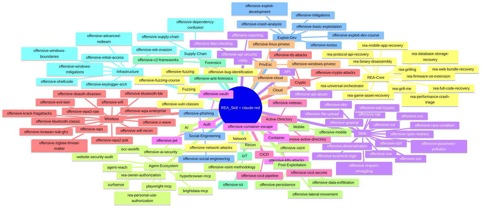

# REA_Skill + claude-red — Unified 100-Skill Mindmap

A visual map of every skill in the library across all **25 categories** and **100 skills**. Use it to navigate the suite, discover specialized reverse-engineering or security-auditing skills, and verify coverage before an engagement or source-recovery project.

References for completeness checking: [REA MCP](https://github.com/morluto/rea), [MITRE ATT&CK](https://attack.mitre.org/), [OWASP WSTG](https://owasp.org/www-project-web-security-testing-guide/), [OWASP MASVS](https://mas.owasp.org/MASVS/), [Matt Pocock Agent Skills Standard](https://github.com/mattpocock/skills), [SnailSploit claude-red](https://github.com/SnailSploit/claude-red).

---

## Library Map (25 Categories · 100 Skills)

