# REA_Skill + claude-red + PayloadsAllTheThings + Understand-Anything — Unified 243-Skill Mindmap

A visual map of every skill in the library across all **41 categories** and **243 skills**. Use it to navigate the suite, discover specialized reverse-engineering, codebase understanding, security-auditing, and payload skills, and verify coverage before an engagement or source-recovery project.

References for completeness checking: [REA MCP](https://github.com/morluto/rea), [Understand Anything](https://github.com/Egonex-AI/Understand-Anything), [PayloadsAllTheThings](https://github.com/swisskyrepo/payloadsallthethings), [MITRE ATT&CK](https://attack.mitre.org/), [OWASP WSTG](https://owasp.org/www-project-web-security-testing-guide/), [OWASP MASVS](https://mas.owasp.org/MASVS/), [Matt Pocock Agent Skills Standard](https://github.com/mattpocock/skills), [SnailSploit claude-red](https://github.com/SnailSploit/claude-red).

---

## Library Map (41 Categories · 243 Skills)

```mermaid
mindmap
  root((REA_Skill Suite))
    Rea-Core
      rea-binary-disassembly
      rea-database-storage-recovery
      rea-firmware-iot-extension
      rea-full-code-recovery
      rea-game-asset-recovery
      rea-grill-me
      rea-grilling
      rea-mobile-app-recovery
      rea-performance-crash-triage
      rea-protocol-api-recovery
      rea-universal-orchestrator
      rea-web-bundle-recovery
    Agent-Ecosystem
      agent-reach
      brightdata-mcp
      ecc-workflow
      hyperbrowser-mcp
      playwright-mcp
      rea-owner-authorization
      rea-personal-use-authorization
      surfsense
      website-security-audit
    Ai-Pentest
      strix
    Privilege-Escalation
      gtfobins
    Web
      offensive-business-logic
      offensive-deserialization
      offensive-file-upload
      offensive-graphql
      offensive-idor
      offensive-open-redirect
      offensive-parameter-pollution
      offensive-race-condition
      offensive-rce
      offensive-request-smuggling
      offensive-sqli
      offensive-ssrf
      offensive-ssti
      offensive-waf-bypass
      offensive-xss
      offensive-xxe
    Auth
      offensive-jwt
      offensive-oauth
    Active-Directory
      offensive-active-directory
      offensive-netexec
    Wireless
      offensive-bluetooth-ble
      offensive-bluetooth-classic
      offensive-deauth-disassoc
      offensive-evil-twin
      offensive-krack-fragattacks
      offensive-lorawan-sub-ghz
      offensive-wifi
      offensive-wifi-recon
      offensive-wpa-enterprise
      offensive-wpa2-psk
      offensive-wpa3-sae
      offensive-wps
      offensive-z-wave
      offensive-zigbee-thread-matter
    Cloud
      offensive-cloud
    Mobile
      offensive-mobile
    Iot
      offensive-iot
    Infrastructure
      offensive-advanced-redteam
      offensive-edr-evasion
      offensive-initial-access
      offensive-keylogger-arch
      offensive-shellcode
      offensive-windows-boundaries
      offensive-windows-mitigations
    Exploit-Dev
      offensive-basic-exploitation
      offensive-crash-analysis
      offensive-exploit-dev-course
      offensive-exploit-development
      offensive-mitigations
      offensive-toctou
    Fuzzing
      offensive-bug-identification
      offensive-fuzzing
      offensive-fuzzing-course
      offensive-vuln-classes
    Recon
      offensive-osint
      offensive-osint-methodology
    Api
      offensive-api-abuse
      offensive-api-security
    Container
      offensive-container-escape
      offensive-k8s-attacks
    Cicd
      offensive-cicd-pipeline
      offensive-cicd-secrets
    Crypto
      offensive-crypto-attacks
      offensive-tls-attacks
    Privesc
      offensive-linux-privesc
      offensive-windows-privesc
    Post-Exploitation
      offensive-data-exfiltration
      offensive-lateral-movement
      offensive-persistence
    Forensics
      offensive-anti-forensics
      offensive-c2-frameworks
    Supply-Chain
      offensive-dependency-confusion
      offensive-supply-chain
    Social-Engineering
      offensive-phishing
      offensive-social-engineering
    Network
      offensive-network-attacks
    Ai
      offensive-ai-security
    Utility
      offensive-fast-checking
      offensive-reporting
    Payloads-Injection
      payloads-cmdi
      payloads-csv
      payloads-graphql
      payloads-hpp
      payloads-latex
      payloads-ldap
      payloads-nosqli
      payloads-prompt-injection
      payloads-proto-pollution
      payloads-saml
      payloads-sqli
      payloads-ssi
      payloads-ssrf
      payloads-ssti
      payloads-xpath
      payloads-xslt
      payloads-xss
      payloads-xxe
    Payloads-Web
      payloads-api-key-leaks
      payloads-ato
      payloads-bizlogic
      payloads-bruteforce
      payloads-cache-deception
      payloads-clickjacking
      payloads-cors
      payloads-crlf
      payloads-csrf
      payloads-css-injection
      payloads-cve
      payloads-dep-confusion
      payloads-deserial
      payloads-file-upload
      payloads-hidden-params
      payloads-idor
      payloads-jwt
      payloads-lfi-rfi
      payloads-mass-assignment
      payloads-oauth
      payloads-open-redirect
      payloads-orm-leak
      payloads-path-traversal
      payloads-race-condition
      payloads-reverse-proxy
      payloads-smuggling
      payloads-type-juggling
      payloads-vhosts
      payloads-websocket
    Payloads-Research
      payloads-cspt
      payloads-dns-rebinding
      payloads-dom-clobbering
      payloads-encoding
      payloads-ext-var
      payloads-gwt
      payloads-headless
      payloads-insecure-random
      payloads-java-rmi
      payloads-mgmt-interface
      payloads-regex
      payloads-scm-exposure
      payloads-tabnabbing
      payloads-xs-leak
      payloads-zip-slip
    Payloads-Resources
      payloads-methodology
    Resources
      awesome-hacking-resources
      awesome-hacking
    Pentest-Tricks
      hacktricks
    Bug-Bounty
      claude-bughunter
    Codebase-Understanding
      understand
      understand-chat
      understand-dashboard
      understand-diff
      understand-domain
      understand-explain
      understand-figma
      understand-knowledge
      understand-onboard
```

