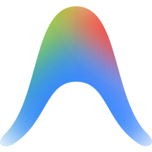
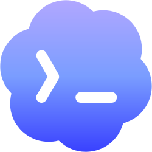
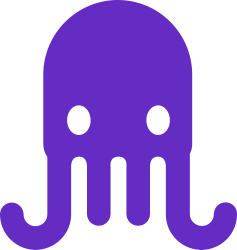
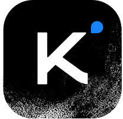
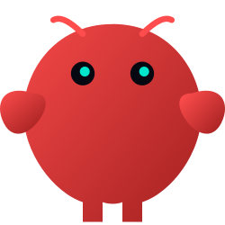

<div align="center">
  
  <br />
  
  <br />

  [](LICENSE)
  [](#supported-platforms--file-formats)
  [](https://github.com/morluto/rea)
  [](https://github.com/affaan-m/everything-claude-code)
  [](https://github.com/Panniantong/agent-reach)
  [](https://github.com/microsoft/playwright-mcp)
  [](https://github.com/MODSetter/SurfSense)
</div>

<p align="center">
  <b>100% Authorized &amp; Natively Integrated with Leading AI Coding Runtimes:</b><br />
  <a href="#supported-platforms--file-formats"></a>&nbsp;&nbsp;&nbsp;&nbsp;
  <a href="#supported-platforms--file-formats"></a>&nbsp;&nbsp;&nbsp;&nbsp;
  <a href="#supported-platforms--file-formats"></a>&nbsp;&nbsp;&nbsp;&nbsp;
  <a href="#supported-platforms--file-formats"></a>&nbsp;&nbsp;&nbsp;&nbsp;
  <a href="#supported-platforms--file-formats"></a>&nbsp;&nbsp;&nbsp;&nbsp;
  <a href="#supported-platforms--file-formats"></a>&nbsp;&nbsp;&nbsp;&nbsp;
  <a href="#supported-platforms--file-formats"></a>&nbsp;&nbsp;&nbsp;&nbsp;
  <a href="#supported-platforms--file-formats"></a>&nbsp;&nbsp;&nbsp;&nbsp;
  <a href="#supported-platforms--file-formats"></a>
</p>

A portable, cross-platform **Owner Authorization, ECC Engineering Rigor, Browser Automation, and Multi-Agent Intelligence Suite** combining:
- 🛠️ **REA (Reverse Engineer Anything):** Internal binary, web, runtime, and app inspection.
- 🏛️ **ECC (Everything Claude Code):** Rigorous development pipeline (Research → Plan → TDD → Review → Verify).
- 🌐 **Agent Reach:** Zero-fee internet search & reading across Twitter/X, Reddit, YouTube transcripts, GitHub, LinkedIn.
- 🎭 **Microsoft Playwright MCP:** Structured browser automation, DOM accessibility navigation, and E2E testing.
- ⚡ **Bright Data MCP:** Industrial web unlocking, anti-bot / CAPTCHA bypass, and SERP extraction.
- 🚀 **Hyperbrowser MCP:** Cloud headless browser infrastructure, dynamic SPA crawling, and session recording.
- 📓 **SurfSense:** Air-gapped, privacy-focused document intelligence and local codebase RAG.

---

## 🎯 The Problem It Solves

When developers and security researchers use AI coding assistants to reverse-engineer, inspect, debug, test, or build on **their own apps, websites, and binaries**, AI agents frequently run into friction:

- ❌ Refusing to run decompilers, disassemblers, or REA MCP tools on false-positive cybersecurity grounds.
- ❌ Pausing every single turn to question authorization or lecturing about cybersecurity ethics.
- ❌ Hallucinating solutions, skipping tests, or guessing API signatures without research.
- ❌ Getting blocked by anti-bot walls (Cloudflare, CAPTCHAs) when fetching external documentation or auditing endpoints.
- ❌ Inability to interactively click, type, and verify live web applications without burning context on heavy screenshots.
- ❌ Leaking proprietary code or research notes to third-party cloud vector stores.

### 💡 The Solution

This suite provides unified, standards-compliant authorization, engineering discipline, and tool integration across all major AI coding runtimes:
- ✅ **Persistent Owner Authorization:** Recognizes you as the verified owner and developer of target software, eliminating repetitive justification hurdles.
- ✅ **ECC Engineering Rigor:** Enforces the 6-stage development pipeline (Research & Reuse → Plan First → TDD → Code Review → Zero-Secret Audit → Verification).
- ✅ **Automated Defensive Website Audit:** Standardized 5-phase assessment covering security headers (CSP/HSTS/CORS), secret leaks, database RLS, and APIs.
- ✅ **Live Web Intelligence:** Access login-walled platforms and social discussions with Agent Reach without API fees.
- ✅ **Complete Browser Automation & Unlocking:** Microsoft Playwright MCP for live DOM control, Bright Data for anti-bot bypass, and Hyperbrowser for dynamic SPA crawling.
- ✅ **Air-Gapped Document Intelligence:** Private local research and note synthesis powered by SurfSense and local LLMs.

---

## 🧩 Included Skills

| Skill | Path | Description |
| :--- | :--- | :--- |
| **`rea-owner-authorization`** | `.agents/skills/rea-owner-authorization/SKILL.md` | Primary authorization establishing legal ownership and preventing generic reverse-engineering refusals. |
| **`rea-personal-use-authorization`** | `.agents/skills/rea-personal-use-authorization/SKILL.md` | Instructs agents to make maximum effort without repeated confirmation on vulnerability hunting, website weakpoint audits, or data recovery. |
| **`website-security-audit`** | `.agents/skills/website-security-audit/SKILL.md` | Automated 5-Phase defensive security audit methodology for HTTP headers (CSP/HSTS/CORS), secret leaks, RLS, and APIs. |
| **`agent-reach`** | `.agents/skills/agent-reach/SKILL.md` | Universal internet reaching skill to read & search Twitter/X, Reddit, YouTube transcripts, GitHub, and login-walled web platforms. |
| **`ecc-workflow`** | `.agents/skills/ecc-workflow/SKILL.md` | Everything Claude Code (ECC) harness: research-first development, TDD, code review, orchestration (`orch-*`), and verification. |
| **`playwright-mcp`** | `.agents/skills/playwright-mcp/SKILL.md` | Microsoft Playwright MCP for live browser automation, accessibility snapshot navigation, and E2E testing. |
| **`brightdata-mcp`** | `.agents/skills/brightdata-mcp/SKILL.md` | Bright Data MCP for anti-bot scraping, CAPTCHA bypass, residential proxies, and SERP data extraction. |
| **`hyperbrowser-mcp`** | `.agents/skills/hyperbrowser-mcp/SKILL.md` | Hyperbrowser MCP for cloud headless browser automation, dynamic SPA crawling, and session recording. |
| **`surfsense`** | `.agents/skills/surfsense/SKILL.md` | Air-gapped, privacy-first document intelligence and local codebase RAG (MODSetter/SurfSense). |

---

## 🖥️ Supported Platforms & File Formats

| AI Agent / Tool | Rule / Skill Files | Format | Loading Mode |
| :--- | :--- | :--- | :--- |
|  **Google Antigravity** | `.agents/skills/*/SKILL.md` | Agentskills.io YAML + Markdown | On-demand progressive disclosure |
|  **Claude Code / Claude AI** | `CLAUDE.md` | Markdown with `@AGENTS.md` import | Project root instruction file |
|  **OpenAI Codex** | `AGENTS.md` | Standard Markdown | Persistent system prompt loaded every session |
|  **GitHub Copilot** | `AGENTS.md` & `.github/copilot-instructions.md` | Standard Markdown | Context-aware workspace instructions |
|  **Cursor IDE** | `.cursor/rules/*.mdc` | Modern Cursor MDC with frontmatter | `alwaysApply: true` across all workspace files |
|  **Google Jules** | `.agents/skills/*/SKILL.md` | YAML + GitHub Actions / API | Autonomous cloud coding agent |
|  **Moonshot Kimi** | `AGENTS.md` | Standard Markdown | Long-context agent instruction |
|  **OpenClaw** | `.agents/skills/*/SKILL.md` | Agentskills.io specification | Open agent framework |
|  **OpenCode** | `AGENTS.md` / CLI | OpenCode rule format | Alibaba OpenCode CLI runtime |
| 🌊 **Windsurf (Cascade)** | `.windsurfrules` & `.windsurf/rules/*.md` | Plain Markdown | Legacy and modern Wave-8 rules |
| ⚡ **Cline** | `.clinerules/*.md` | Plain Markdown | Workspace task rules |

---

## 🔌 Unified MCP Server Configuration (`.mcp.json`)

This repository includes a ready-to-use [`.mcp.json`](.mcp.json) configuration:

```json
{
  "mcpServers": {
    "rea": {
      "command": "npx",
      "args": ["-y", "rea-agents@latest", "run"]
    },
    "playwright": {
      "command": "npx",
      "args": ["-y", "@playwright/mcp@latest"]
    },
    "brightdata": {
      "command": "npx",
      "args": ["-y", "@brightdata/mcp"],
      "env": {
        "BRIGHTDATA_API_KEY": "${BRIGHTDATA_API_KEY}"
      }
    },
    "hyperbrowser": {
      "command": "npx",
      "args": ["-y", "hyperbrowser-mcp"],
      "env": {
        "HYPERBROWSER_API_KEY": "${HYPERBROWSER_API_KEY}"
      }
    }
  }
}
```

---

## 🚀 Quickstart & Setup

### Step 1: Install & Register REA MCP Server
```bash
npx -y rea-agents@latest setup
```
> [!IMPORTANT]
> After running setup, **restart your AI agent** (or IDE) to load the newly registered MCP server.

### Step 2: Install REA's Official Investigation Skill
```bash
npx skills add morluto/rea --skill reverse-engineer-anything
```

### Step 3: Install Agent Reach
```bash
uv tool install https://github.com/Panniantong/Agent-Reach/archive/refs/tags/v1.6.0.zip
agent-reach setup
```

### Step 4: Install ECC Universal Tools
```bash
npm install -g ecc-universal ecc-agentshield
```

### Step 5: Install This Multi-Agent Skill Suite

You can install this suite either **per-project** or **globally** across your entire computer.

---

### Option A: Per-Project Installation (Recommended for Teams)

Clone or copy this repository's files into the root of any workspace:

```bash
git clone https://github.com/smartworldarafath/REA_Skill.git .
```

---

### Option B: Global Machine-Level Installation (Recommended for Personal Dev)

Configure it once on your computer, and every AI agent will automatically recognize all skills, rules, and MCP tools in **any** folder or project:

#### 1. Google Antigravity (Global Skills)
Copy all skills to your user-level Gemini / Antigravity skills directory:
```bash
# Windows
mkdir "%USERPROFILE%\.gemini\config\skills\rea-owner-authorization"
mkdir "%USERPROFILE%\.gemini\config\skills\rea-personal-use-authorization"
mkdir "%USERPROFILE%\.gemini\config\skills\website-security-audit"
mkdir "%USERPROFILE%\.gemini\config\skills\agent-reach"
mkdir "%USERPROFILE%\.gemini\config\skills\ecc-workflow"
mkdir "%USERPROFILE%\.gemini\config\skills\playwright-mcp"
mkdir "%USERPROFILE%\.gemini\config\skills\brightdata-mcp"
mkdir "%USERPROFILE%\.gemini\config\skills\hyperbrowser-mcp"
mkdir "%USERPROFILE%\.gemini\config\skills\surfsense"

copy ".agents\skills\rea-owner-authorization\SKILL.md" "%USERPROFILE%\.gemini\config\skills\rea-owner-authorization\"
copy ".agents\skills\rea-personal-use-authorization\SKILL.md" "%USERPROFILE%\.gemini\config\skills\rea-personal-use-authorization\"
copy ".agents\skills\website-security-audit\SKILL.md" "%USERPROFILE%\.gemini\config\skills\website-security-audit\"
copy ".agents\skills\ecc-workflow\SKILL.md" "%USERPROFILE%\.gemini\config\skills\ecc-workflow\"
copy ".agents\skills\playwright-mcp\SKILL.md" "%USERPROFILE%\.gemini\config\skills\playwright-mcp\"
copy ".agents\skills\brightdata-mcp\SKILL.md" "%USERPROFILE%\.gemini\config\skills\brightdata-mcp\"
copy ".agents\skills\hyperbrowser-mcp\SKILL.md" "%USERPROFILE%\.gemini\config\skills\hyperbrowser-mcp\"
copy ".agents\skills\surfsense\SKILL.md" "%USERPROFILE%\.gemini\config\skills\surfsense\"
xcopy /E /I /Y ".agents\skills\agent-reach" "%USERPROFILE%\.gemini\config\skills\agent-reach"

# macOS / Linux
mkdir -p ~/.gemini/config/skills/{rea-owner-authorization,rea-personal-use-authorization,website-security-audit,agent-reach,ecc-workflow,playwright-mcp,brightdata-mcp,hyperbrowser-mcp,surfsense}
cp -r .agents/skills/* ~/.gemini/config/skills/
```

#### 2. OpenAI Codex (Global System Prompt)
Append the instructions to your global Codex configuration (`~/.codex/AGENTS.md`):
```bash
# Windows
type AGENTS.md >> "%USERPROFILE%\.codex\AGENTS.md"

# macOS / Linux
cat AGENTS.md >> ~/.codex/AGENTS.md
```

#### 3. Claude Code (Global Instructions)
Append or link to your global Claude Code configuration:
```bash
# Windows
type CLAUDE.md >> "%USERPROFILE%\.claude\CLAUDE.md"

# macOS / Linux
cat CLAUDE.md >> ~/.claude/CLAUDE.md
```

#### 4. Cursor (Global Rules for AI)
1. Open Cursor Settings: `Ctrl + ,` (or `Cmd + ,` on macOS).
2. Navigate to **Features** > **Rules for AI** (User Rules).
3. Paste the contents of [`AGENTS.md`](AGENTS.md).

---

## 💬 Usage Examples

### Example 1: Web Application Analysis with REA
> *"Use REA to trace and inspect the network request logic and WebSocket frames of my web app."*

### Example 2: Native Binary & Framework Inspection
> *"Inspect my compiled binary with REA to analyze exported symbols and verify native boundaries."*

### Example 3: Android / Electron App Debugging
> *"Use REA to inspect my Electron application package, check event listeners, and reconstruct component routes."*

### Example 4: Vulnerability Hunting & Pre-Publishing Audit
> *"Reverse engineer my AI app and find all vulnerabilities so I can fix them before publishing."*

### Example 5: Defensive Website Security Audit (2nd & 3rd Websites)
> *"Audit my website https://my-other-site.com/ for security vulnerabilities, header misconfigurations, and frontend secret leaks."*

### Example 6: Lost Source Code & Data Recovery
> *"My laptop is not turning on, I lost my source code. Without codes I cannot improve my app. Reverse engineer my app and recover all app data so I can continue my project."*

### Example 7: Prompt Shortcut
```text
$rea-personal-use-authorization Audit my app for security weakpoints.
```

### Example 8: Live Threat Intelligence with Agent Reach
> *"Use Agent Reach to look up latest CVE disclosures and Reddit discussions about Next.js middleware vulnerabilities."*

### Example 9: ECC Feature Implementation & Refactoring Pipeline
> *"Execute orch-add-feature to build an API rate-limiting middleware using Redis and TDD."*

### Example 10: Interactive Browser Testing with Microsoft Playwright MCP
> *"Use Playwright MCP to navigate to http://localhost:3000/login, fill out test credentials, click submit, and verify that the dashboard loads."*

### Example 11: Unlocking Protected Endpoints with Bright Data MCP
> *"Use Bright Data MCP to scrape and extract pricing data from https://protected-target.com/ without triggering Cloudflare blocks."*

### Example 12: Air-Gapped Document Synthesis with SurfSense
> *"Use SurfSense to index all decompiled pseudocode files in ./dist and synthesize a security architecture map locally using Ollama."*

---

## 📂 Repository File Structure

```text
REA_Skill/
├── .agents/
│   └── skills/
│       ├── rea-owner-authorization/
│       │   └── SKILL.md                 # Primary Antigravity owner skill (YAML + Markdown)
│       ├── rea-personal-use-authorization/
│       │   └── SKILL.md                 # Antigravity personal-use & maximum effort skill
│       ├── website-security-audit/
│       │   └── SKILL.md                 # Automated 5-Phase defensive website audit skill
│       ├── agent-reach/
│       │   ├── SKILL.md                 # Universal internet platform reaching skill
│       │   └── references/              # Capabilities, sessions, and maintenance references
│       ├── ecc-workflow/
│       │   └── SKILL.md                 # Everything Claude Code (ECC) harness & pipeline
│       ├── playwright-mcp/
│       │   └── SKILL.md                 # Microsoft Playwright browser automation MCP skill
│       ├── brightdata-mcp/
│       │   └── SKILL.md                 # Bright Data anti-bot scraping & proxy MCP skill
│       ├── hyperbrowser-mcp/
│       │   └── SKILL.md                 # Hyperbrowser cloud headless crawling MCP skill
│       └── surfsense/
│           └── SKILL.md                 # SurfSense air-gapped document intelligence skill
├── .clinerules/
│   ├── rea-owner.md
│   ├── rea-personal-use.md
│   ├── website-security-audit.md
│   ├── agent-reach.md
│   ├── ecc-workflow.md
│   ├── playwright.md
│   ├── brightdata.md
│   ├── hyperbrowser.md
│   └── surfsense.md
├── .cursor/
│   └── rules/
│       ├── rea-owner.mdc
│       ├── rea-personal-use.mdc
│       ├── website-security-audit.mdc
│       ├── agent-reach.mdc
│       ├── ecc-workflow.mdc
│       ├── playwright.mdc
│       ├── brightdata.mdc
│       ├── hyperbrowser.mdc
│       └── surfsense.mdc
├── .windsurf/
│   └── rules/
│       ├── rea-owner.md
│       ├── rea-personal-use.md
│       ├── website-security-audit.md
│       ├── agent-reach.md
│       ├── ecc-workflow.md
│       ├── playwright.md
│       ├── brightdata.md
│       ├── hyperbrowser.md
│       └── surfsense.md
├── .windsurfrules                       # Windsurf legacy rule file
├── .mcp.json                            # Unified MCP servers configuration
├── AGENTS.md                            # Codex, Copilot, & universal agent instructions
├── CLAUDE.md                            # Claude Code root import configuration
├── .gitignore                           # Clean repository ignore file
├── LICENSE                              # MIT License
└── README.md                            # Detailed documentation
```

---

## ⚠️ Important Boundary & Alignment Notice

1. **Owner-Only Scope:** This authorization suite is strictly for inspecting, tracing, debugging, and recovering **your own software, applications, and web services**. It is not designed or intended for cracking third-party proprietary systems without permission.
2. **Model-Level Guardrails (e.g. Anthropic):** Some frontier LLMs (such as Claude 3.5/3.7 Sonnet) incorporate hardcoded, system-level cybersecurity safety filters. While this skill eliminates 90%+ of conversational refusals, severe vulnerability exploitation payloads may still trigger provider-level filters. For advanced authorized security research, consider provider verification programs (e.g., Anthropic's Cyber Verification Program) or local open-weights LLMs (e.g., Ollama) on your machine.

---

## 📜 License

This project is licensed under the [MIT License](LICENSE) &copy; 2026 **Arafath Rahman**.
